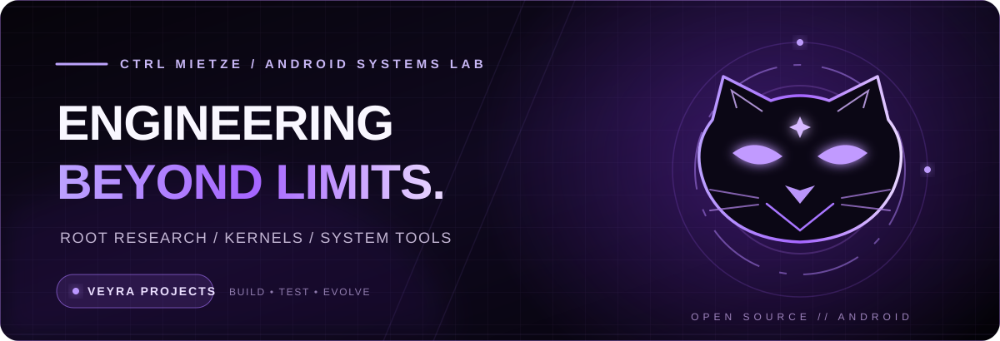
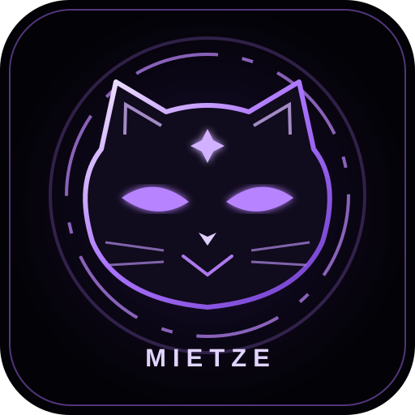
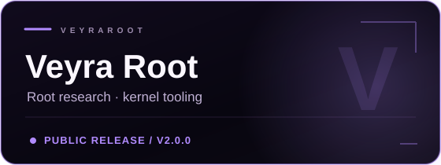
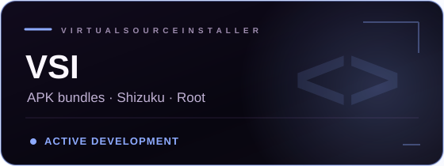
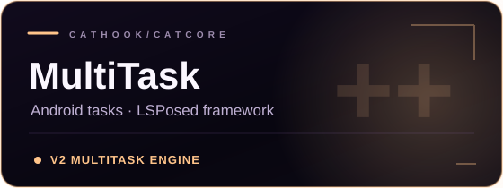
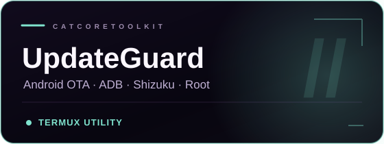

 
 

# Hey, I'm Mietze. 💜

**Android systems developer · Root & kernel research · Builder of Veyra**

I build Android tools that make powerful features more accessible, understandable and controllable.  
From kernel research to app installation, system hooks and multitasking — I'm interested in what happens *under the hood*.

 

 

`ANDROID` &nbsp;·&nbsp; `KERNELSU` &nbsp;·&nbsp; `LSPOSED` &nbsp;·&nbsp; `SHIZUKU` &nbsp;·&nbsp; `ADB` &nbsp;·&nbsp; `OPEN SOURCE`

---

### 01 / About me

I'm a developer from Germany with a strong interest in Android internals, system integration, root frameworks and practical automation. My work revolves around building useful tools, exploring how operating systems behave and refining ideas into real projects.

- **What I enjoy:** Android engineering, reverse engineering, system-level tools, automation and thoughtful UI.
- **How I work:** inspect first, understand the risks, document decisions, test deliberately.
- **What matters:** reproducibility, compatibility, proper upstream credits and user control.

> **Build boldly. Verify carefully.** Especially when code operates near the kernel.

### 02 / Featured projects

<table>
  <tr>
    <td width="50%" align="center"></td>
    <td width="50%" align="center"></td>
  </tr>
  <tr>
    <td align="center"></td>
    <td align="center"></td>
  </tr>
</table>

**[Veyra Root](https://github.com/ctrl-mietze/Veyra)** — An Android root and kernel-research project that prioritizes exact device evidence over guessed kernel writes. The public **v2.0.0** release includes root/provider management and research tooling. [Latest release ↗](https://github.com/ctrl-mietze/Veyra/releases/latest)

**[VSI — Virtual Source Installer](https://github.com/ctrl-mietze/VSI)** — An Android package installer for APKs and split-package workflows with Root, Shizuku and experimental framework integrations. Built from the open-source SAI foundation, with attribution and GPLv3 licensing preserved. *In active development.*

**[CatHook MultiTask](https://github.com/ctrl-mietze/CatHook-MultiTask-Launcher)** — Android multitasking and workspace experiments with LSPosed integration, task management and compatibility-oriented launch flows.

**[CatCore UpdateGuard](https://github.com/ctrl-mietze/CatCore-UpdateGuard)** — A Termux-based toolkit to manage unwanted Android OTA/update components using Root, ADB or Shizuku. Designed for users who want control over when device updates happen.

Other public work includes the <a href="https://github.com/ctrl-mietze/DIOXAMINE-plugin-store">DIOXAMINE Plugin Store</a> and earlier <a href="https://github.com/ctrl-mietze/Dioxamine">Dioxamine experiments</a>.

### 03 / My toolkit

 

### 04 / Engineering principles

| Principle | What it means to me |
| :-- | :-- |
| **Evidence over assumptions** | Never treat a similar device name or kernel version as proof of compatibility. |
| **User control** | Powerful operations should be explicit, reversible where possible and easy to understand. |
| **Clean architecture** | Keep system-level logic testable and separate from presentation. |
| **Credit the foundations** | Respect upstream projects, their authors and their licenses. |

### 05 / Follow the journey

**Android is more interesting when you can understand it — and make it your own.**

<a href="https://github.com/ctrl-mietze/Veyra">Explore Veyra Root</a> &nbsp;·&nbsp;
<a href="https://github.com/ctrl-mietze?tab=repositories">Browse repositories</a> &nbsp;·&nbsp;
<a href="https://www.reddit.com/r/VeyraCore/">Join r/VeyraCore</a>

 

Designed for curiosity. Built with care. Made by ctrl-mietze. 💜

